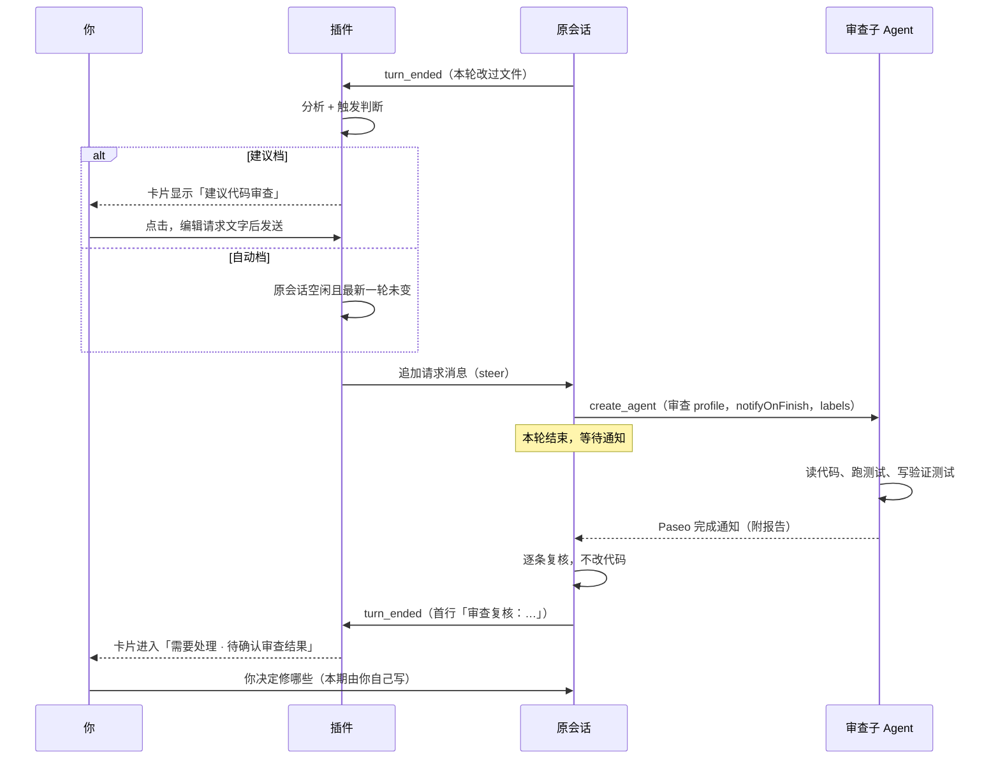

# 任务完成后的独立代码审查（技术方案）

状态：待确认 · 2026-10-14

## 背景

会话看板在每轮对话结束后做一次只读分析。Agent 改完代码自称「完成」后，目前没有独立的第二双眼睛看一遍。本方案借鉴 todos.dev 的 AI review gate，但**不做自动修复**：插件只负责判断「该审查了」，然后在原会话追加一段话，让原会话自己用 Paseo 起一个审查子 Agent；审查完由原会话逐条复核，最后交给人决定修哪些。

## 目标

1. 分析器判断出「刚完成了一项值得审查的代码改动」时，按设置给出建议或自动发起审查。
2. 审查子 Agent 与普通子 Agent 完全一样：由原会话通过 Paseo `create_agent` 创建，profile 由原会话从已配置的「代码 Review」类 profile 中自己挑，完成后走 Paseo 原生完成通知回到原会话。
3. 原会话收到报告后逐条复核（成立 / 不成立 / 存疑），**不修改代码**，然后停下等人确认。
4. 发给原会话的那段话可编辑：设置里有模板；手动发起时可以先改再发。
5. 卡片上能看到审查进度：建议审查 → 已请求 → 审查中 → 复核中 → 待确认审查结果。

## 范围

**做**：触发判断、请求消息（模板 + 发送）、审查进度跟踪与展示、相关设置项。

**不做（本期）**：自动修复、修复后自动复审、轮数预算与循环检测（人始终在环内，不会自转）、Paseo 重启后自动恢复被中断的审查、按复核结论一键修复的按钮。

## 关键事实（已核实）

| 事实 | 依据 | 对方案的影响 |
|---|---|---|
| Paseo 的「子 Agent 完成 → 通知父 Agent」只在 Agent 用 MCP `create_agent` 且 `notifyOnFinish=true` 创建时生效；插件用 SDK `agents.create` 创建的即使设了 `parent` 也不通知 | daemon `agent/create-agent/create.js:54`（只对 `kind === "mcp"` 挂 `setupFinishNotification`） | 让原会话自己创建子 Agent，插件不创建 |
| 完成通知以 `steer` 方式送达父 Agent，正文带子 Agent 最后一条回复，超过 4000 字截断并提示用 `get_agent_activity` 取全文 | daemon `agent/agent-prompt.js` `formatFinishNotificationBody` | 报告长也没关系，原会话能自己取全文 |
| 子 Agent 需要授权时，Paseo 也会通知父 Agent | 同上，`reason === "needs permission"` | 插件不用处理审查子 Agent 的授权 |
| 完成通知的订阅只在 daemon 内存里，Paseo 重启后丢失 | 同上，`setupFinishNotification` 是内存订阅 | 重启中断要单独标出来（本期只展示，不自动恢复） |
| MCP `create_agent` 支持 `labels`；没有 `profile` 参数，需先 `list_profiles` 再抄字段 | daemon `agent/tools/paseo-tools.js:698`、`list_profiles` 说明 | 模板里要求原会话打 `session-manager.review=<标识>` 标签 |
| 已配置的审查 profile：`代码 Review`（claude / opus xhigh）、`代码 Review-B`（codex / gpt-6.1-sol） | `list_profiles` | 两个 profile 的说明写着「只读，不修改代码」，但子 Agent 看不到说明，只看原会话写的 prompt；模板里显式允许新增测试 |
| `turn_ended.timeline` 带 `tool_call`，`detail.type` 有 `edit` / `write` | `@getpaseo/protocol` `ToolCallDetail` | 可确定性地知道一轮里有没有改文件 |
| `send()` 在会话忙时默认打断当前轮，只支持 `interrupt` / `steer` | `@getpaseo/client` `SendMessageOptions` | 插件发请求一律用 `steer`，且发前确认原会话空闲 |

## 方案

### 整体流程



### 触发判断

分析结束后（`server/service.ts` `runAnalysis` 成功分支，现有 `maybeWriteBackTitle` 旁边）计算 `reviewEligibility(record, records, settings)`，纯函数放 `server/review.ts`。

**硬条件**（全部满足，确定性判断）：

1. 设置 `reviewTrigger` 不是 `off`。
2. 会话 `live`、`lifecycle === "idle"`、没有待授权请求、未归档。
3. 最新一轮 `outcome === "completed"`，且就是本次分析的那一轮。
4. 有未审查的改动：`reviewedThroughTurnId` 之后各轮的 `editCount` 之和大于 0（`reviewedThroughTurnId` 已滑出 12 轮窗口时按全部已存轮次算）。
5. 不是 /dev-team：自身没有 `team` 标签；没有带 `team` 标签的子 Agent；`firstUserMessage` 不以 `/dev-team` 开头。dev-team 自带双人审查。
6. 不是审查子 Agent：自身没有 `session-manager.review` 标签，且不在任何会话的 `review.reviewerIds` 里。**防止审查子 Agent 写了测试后又被判成需要审查。**
7. 没有进行中的审查（`review` 为空或已关闭）。
8. 本轮没被你忽略过（`reviewDismissedTurnId !== 最新轮 id`）。

**软条件**（LLM）：分析结果新增 `review: { suggested: boolean; reason: string }`。提示词规则：

> `review.suggested`：只有 isNew 的轮次里 Agent 完成了一项可交付的代码改动（功能、修复、重构），且改动涉及程序逻辑时为 true；只改文档、注释、配置、格式，仍在探索、在等用户回答、或任务没做完时为 false。turns 里的 `editCount` 是该轮编辑文件的次数，可作参考。`review.reason` 一句话说明理由，不超过 40 字。

硬条件 + 软条件都满足 → 「建议审查」。建议档只显示；自动档在发送前**再确认一次**条件 2、3（原会话仍空闲、最新一轮未变），否则退回为建议。

手动发起（详情页「代码审查」按钮）只检查条件 2、5、6、7，不看改动和 LLM 建议；设置为 `off` 时也可以手动发起。

误报控制：默认「建议」档；硬条件 4 排除了没改文件的轮次；「忽略」按钮按轮次记住；`editCount` 只统计 `edit` / `write`，用 shell 命令改文件的情况会漏判，此时用手动按钮补。

### 请求消息

设置项 `reviewPrompt`，空字符串表示使用内置模板。设置页沿用 `client/prompt-editor.tsx` 的编辑器，带「恢复默认」。占位符：

| 占位符 | 替换为 |
|---|---|
| `{审查范围}` | 按 `reviewScope` 生成的一句话（见下表） |
| `{审查标识}` | 本次请求的 id，如 `rv_m2x9k1` |

`reviewScope` 对应的文字：

| 取值 | 文字 |
|---|---|
| `uncommitted` | 当前工作区尚未提交的改动（`git diff HEAD`，含新增文件） |
| `since_last_review`（默认） | 有上次审查记录时：自上次代码审查以来的改动（`<上次 HEAD 短 sha>..当前工作区`，含未提交改动），以你在本会话中做的改动为准；没有时：本会话中你所做的全部代码改动 |
| `session` | 本会话中你所做的全部代码改动 |

内置模板：

```text
【代码审查】请为你刚完成的代码改动发起一次独立代码审查，并在审查结束后复核结果。本轮只审查和复核，不要修复任何问题。

1. 用 Paseo 的 list_profiles 选择合适的代码审查 profile，用 create_agent 创建一个审查子 Agent：background 和 notifyOnFinish 设为 true，labels 加上 session-manager.review={审查标识}。创建后结束本轮，等待完成通知，不要轮询。
2. 审查范围：{审查范围}。给子 Agent 的 prompt 写清审查范围、这次改动要达成的目标、你认为需要重点关注的风险。
3. 告诉子 Agent：可以运行测试和类型检查，也可以新增测试代码来验证发现的问题，新增的测试保留；不要修改业务代码，不要 git commit。报告按 阻断 / 重要 / 建议 分级，编号 B1、I1、S1…，每条给出 file:line、触发场景和证据。
4. 收到审查结果后逐条复核：成立 / 不成立 / 存疑，各附一句理由。复核期间不要修改代码，不要提交。
5. 复核回复的第一行写：「审查复核：成立 X 条，不成立 Y 条，存疑 Z 条」，然后列出逐条结论，最后等我确认要修哪些。
```

模板可以随意改。标签和首行格式只用来**提高跟踪精度**，删掉后退化为启发式（见「进度跟踪」），不会出错。

**发送**：

- 建议档点击 / 手动按钮 → 先调 `review.preview` 取渲染好的文字，在弹窗里编辑（复用 `PromptEditor` 的 Modal + 多行输入），点「发送」调 `review.request { id, text }`。
- 自动档 → 直接用渲染好的模板。
- 统一走 `paseo.agents.ref(id).send(text, { activeTurnBehavior: "steer" })`，外面套 `withTimeout`（沿用 `notifyCoordinator` 的写法）。发送前执行 `git -C <cwd> rev-parse HEAD` 记下 `baseHead`，不是 git 目录时为 null，不阻止发送。

### 数据模型

`shared/types.ts`：

```ts
// Turn 新增；老数据缺省视为 0
editCount?: number;
/** 首行「审查复核：成立 X 条，不成立 Y 条，存疑 Z 条」解析结果 */
reviewVerdict?: ReviewVerdict | null;

// Analysis 新增；老分析缺省视为未建议
review?: { suggested: boolean; reason: string };

export type ReviewVerdict = { valid: number; invalid: number; unsure: number };

export const REVIEW_PHASES = [
  "suggested",              // 建议审查
  "requested",              // 已请求，原会话正在创建子 Agent
  "reviewing",              // 审查中
  "verifying",              // 复核中
  "awaiting_confirmation",  // 待确认审查结果
  "failed",                 // 原会话没有创建子 Agent / 发送失败
  "interrupted",            // 审查子 Agent 被 Paseo 重启中断
] as const;

/** SessionView 新增：投影出来的审查状态，null 表示无 */
review: {
  phase: ReviewPhase;
  requestId: string | null;
  reason: string | null;        // 建议理由或失败原因
  reviewerIds: string[];
  verdict: ReviewVerdict | null;
  editedDuringVerify: boolean;  // 复核那一轮出现了编辑
  requestedAt: number | null;
} | null;
```

`server/store.ts` `SessionRecord` 新增（持久化，hydrate 时缺省为 null 或空）：

```ts
review: {
  id: string;                 // rv_<base36>，同时作为标签值
  turnId: string;             // 发起时的最新轮
  trigger: "auto" | "manual";
  requestedAt: number;
  baseHead: string | null;
  reviewerIds: string[];      // 归属到本次请求的子 Agent
  verifiedTurnId: string | null;
  verdict: ReviewVerdict | null;
  error: string | null;
  closedAt: number | null;    // 你回复后关闭；保留用于详情展示
} | null;
reviewedThroughTurnId: string | null;  // 这一轮及之前的改动视为已审查
lastReviewHead: string | null;         // since_last_review 的基线
reviewDismissedTurnId: string | null;
```

### 进度跟踪

事实由钩子写入，阶段在投影时推导。推导比事件驱动更抗丢事件（插件 reload 期间漏掉的钩子靠 reconcile 补齐）。

**写入事实**：

| 时机 | 写入 |
|---|---|
| `review.request` 发送成功 | `review = { id, turnId, trigger, requestedAt, baseHead, … }`，`reviewedThroughTurnId = turnId`，`lastReviewHead = baseHead` |
| `agent.created` 且 `parentAgentId` 是某个有进行中 review 的会话，并且创建时间不早于 `requestedAt` | 追加到 `reviewerIds`。标签探测（`probeLabels`）回来后，若带 `session-manager.review` 但值不等于本次 id，就移除（原会话本来就在派别的子 Agent 时，防止误归属） |
| reconcile | 对进行中的 review，从 `agents.list` 补齐 `parentAgentId` 匹配的子 Agent |
| 原会话 `turn_ended` | 若所有审查子 Agent 都已结束、且本轮开始晚于它们结束：`verifiedTurnId = 本轮`，`verdict = turn.reviewVerdict` |
| 原会话 `turn_started` | 若 `verifiedTurnId` 已设置且没有仍在运行的审查子 Agent：`closedAt = now`（你回复了，本次审查结束） |

**推导阶段**（`server/review.ts` `reviewPhaseOf(record, reviewers, now)`，纯函数）：

```
review 为空或已关闭 → 满足建议条件则 suggested，否则 null
review.error → failed
任一审查子 Agent interruptedAt ≠ null → interrupted
verifiedTurnId ≠ null → awaiting_confirmation
reviewerIds 为空：
    原会话 working → requested
    原会话 idle 且最后一轮完成时间 > requestedAt → failed（原会话没有创建审查子 Agent）
任一审查子 Agent working 或待授权 → reviewing
审查子 Agent 都已结束：
    原会话 working → verifying
    否则 → reviewing（等待完成通知送达）
```

`projectView` 需要拿到其他记录，签名改为 `projectView(record, now, lookup?)`，`snapshot` 和 `detail` 传入 `records` 的查找函数。

**看板列**（`server/projection.ts` `effectiveStatusOf`）的优先级插在「运行中」之后、「自我声明」之前：

```
手动 > 重启中断 > 待授权 > 运行中 > 审查阶段 > 自我声明 > LLM
```

- `requested` / `reviewing` / `verifying` → `in_progress`（原会话空闲，但在等它的子 Agent）
- `awaiting_confirmation` / `failed` / `interrupted` → `waiting_for_user`
- `suggested` → 不改列，只加标记

**卡片和详情**：

- 卡片标记：建议代码审查 · 已请求审查 · 审查中 · 复核中 · 待确认审查结果（成立 X / 不成立 Y / 存疑 Z）· 审查未启动 · 审查被中断；复核轮出现编辑时追加「复核时改了代码」。
- 详情「现在」行（`shared/presentation.ts` `nowLine`）在原会话空闲时优先显示审查阶段，`detail` 写建议理由或失败原因。
- 详情按钮：「代码审查」（打开编辑弹窗）、「忽略建议」（仅建议阶段）。审查子 Agent 作为普通子会话卡片出现在看板上，不做特殊处理。

### 接口变更

| 类别 | 名称 | 说明 |
|---|---|---|
| 设置 | `reviewTrigger: "off" \| "suggest" \| "auto"` | 默认 `suggest` |
| 设置 | `reviewScope: "uncommitted" \| "since_last_review" \| "session"` | 默认 `since_last_review` |
| 设置 | `reviewPrompt: string` | 默认 `""`（内置模板） |
| RPC | `session-manager.review.preview { id } → { text }` | 渲染好的请求文字 |
| RPC | `session-manager.review.request { id, text? } → MutationResult` | 发送；`text` 为空用模板 |
| RPC | `session-manager.review.dismiss { id } → MutationResult` | 忽略当前建议 |
| 分析 schema | `review: { suggested, reason }`（必填） | 老数据 hydrate 时可缺省 |
| 分析输入 | `turns[].editCount` | 给 LLM 参考 |

设置用 zod default 补新字段，`version` 不变。若实测发现旧设置读不到新字段的默认值，再加 `migrate`。

## 变更点

| 文件 | 改动 |
|---|---|
| `shared/types.ts` | 新增 `editCount`、`reviewVerdict`、`Analysis.review`、`REVIEW_PHASES`、`SessionView.review` |
| `shared/settings.ts` | 新增 3 个设置项 |
| `shared/rpc.ts` | 新增 3 个 RPC |
| `shared/presentation.ts` | 审查阶段文案；`nowLine` 加审查分支 |
| `server/turns.ts` | 统计 `edit` / `write` 次数；`FinalReply` 旁边加 `reviewVerdictFrom` |
| `server/store.ts` | 新字段的 hydrate、copy、bound |
| `server/analyzer/prompt.ts`、`output.ts` | schema、规则、解析（`reviewTrigger === "off"` 时不加这条规则和字段，省 token） |
| `server/review.ts`（新） | `reviewEligibility`、`reviewPhaseOf`、`renderReviewPrompt`、`parseReviewVerdict`、`DEFAULT_REVIEW_PROMPT` |
| `server/service.ts` | 分析后自动触发；`requestReview` / `dismissReview` / `previewReview`；`onCreated` 归属子 Agent；`onTurnStarted` 关闭审查；`onTurnEnded` 写 `verifiedTurnId`；reconcile 补齐 |
| `server/projection.ts` | `effectiveStatusOf` 插入审查阶段；`projectView` 接收 lookup |
| `server/rpc-handlers.ts` | 注册 3 个 RPC |
| `client/session-card.tsx`、`detail-content.tsx`、`settings-screen.tsx` | 标记、按钮、编辑弹窗、设置项 |
| 测试 | `turns`、`review`、`projection`、`service`、`store`、`prompt` 各补用例 |

注意：`server/service.ts`、`shared/presentation.ts`、`shared/types.ts` 目前有别的改动在进行（重新打开已关闭会话），实施时要基于它们合并。

## 时序与边界验证

| # | 场景 | 结果 |
|---|---|---|
| T1 | 自动档发送的同一时刻，你也给原会话发了消息 | 发前再确认空闲和最新轮；仍撞上时 `steer` 不会打断你的轮次，只是把请求并进去。最坏情况是这一轮同时处理你的消息和审查请求，可接受 |
| T2 | 审查进行中，你又让原会话做别的事 | Paseo 原生通知以 `steer` 并入你那一轮；只要「审查子 Agent 已结束」之后原会话有一轮结束，就进入待确认，首行格式缺失时没有计数 |
| T3 | 原会话一次派了两个审查子 Agent（两个 profile 都用了） | `reviewerIds` 是数组；全部结束才记 `verifiedTurnId`；第一个结束触发的复核轮不会关闭审查，因为还有子 Agent 在运行 |
| T4 | 插件 reload 期间子 Agent 被创建 | reconcile 按 `parentAgentId` + 创建时间补进 `reviewerIds` |
| T5 | Paseo 重启时审查子 Agent 正在跑 | 子 Agent `interruptedAt` 被设置 → 阶段 `interrupted` → 卡片进「需要处理」，由你手动恢复。本期不自动恢复 |
| T6 | 原会话没照模板做（没创建子 Agent，直接回复了） | 请求轮结束、`reviewerIds` 为空 → `failed`「原会话没有创建审查子 Agent」 |
| F1 | 状态分叉：审查子 Agent 写了测试，自己的 `editCount > 0`，分析器也可能建议审查它 | 硬条件 6 按标签或 `reviewerIds` 排除，不会递归 |
| F2 | 状态分叉：复核轮原会话违反要求改了代码 | 该轮 `editCount > 0` → 标「复核时改了代码」；`reviewedThroughTurnId` 停在请求轮，这些改动下次仍算未审查 |
| F3 | 同一轮被自动触发一次，你又手动点了一次 | 硬条件 7 拒绝第二次，返回「已有进行中的审查」 |

## 风险

| 风险 | 缓解 |
|---|---|
| LLM 建议误报，自动档浪费额度（审查 profile 是 opus / gpt xhigh） | 默认「建议」档；硬条件 4 要求真改过文件；可按轮忽略 |
| 原会话不照模板执行（不打标签、不写首行、复核时修了代码） | 标签和首行只用来提高精度，都有退化路径；复核轮改代码会被标出 |
| 审查子 Agent 和原会话共用目录，你中途让原会话干活时两边同时写文件 | 审查主要是新增测试文件，冲突概率低；本期接受 |
| 多个会话共用一个仓库，`since_last_review` 的 HEAD 范围会混进别的会话的提交 | 模板写明「以你在本会话中做的改动为准」 |
| 用 shell 命令改文件的轮次统计不到 `editCount` | 手动按钮兜底 |
| profile 说明写着「只读」，与「可以写测试」冲突 | 子 Agent 只看原会话写的 prompt，模板显式允许；建议顺手改一下两个审查 profile 的说明 |
| Paseo 重启后完成通知丢失 | 本期标「审查被中断」；二期参照 `team-recovery.ts` 自动通知原会话 |

## 分期

- **一期（本文）**：触发判断、可编辑的请求模板与发送、进度跟踪与展示、3 个设置项。
- **二期候选**：Paseo 重启后自动恢复审查（复用 team-recovery）；「按复核结论修复」按钮；修复后自动复审；统计建议的采纳率，为是否默认开自动档提供依据。

## 验收

1. 设置为「建议」：Agent 改完代码并声明完成后，卡片出现「建议代码审查」；点开能编辑请求文字，发送后原会话出现这段话。
2. 原会话创建审查子 Agent 后，原会话卡片显示「审查中」，子 Agent 作为普通子会话出现。
3. 子 Agent 完成后原会话自动开始复核，卡片显示「复核中」；复核结束进入「需要处理」，显示「待确认审查结果（成立 X / 不成立 Y / 存疑 Z）」。
4. 你回复原会话后，审查标记消失；之后没有新改动时不再建议审查。
5. 设置为「自动」：同样的流程无需点击；原会话忙时不发送。
6. 只改文档、或没有改文件的轮次不出现建议；/dev-team 的协调者和子 Agent、审查子 Agent 自己都不出现建议。
7. `npx tsc --noEmit && npm test` 通过，`paseo plugin reload session-manager` 后 `Loaded plugin` 日志里能看到 3 个新 RPC。
