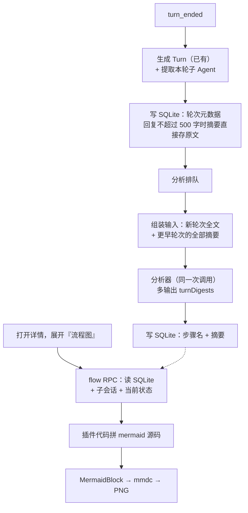
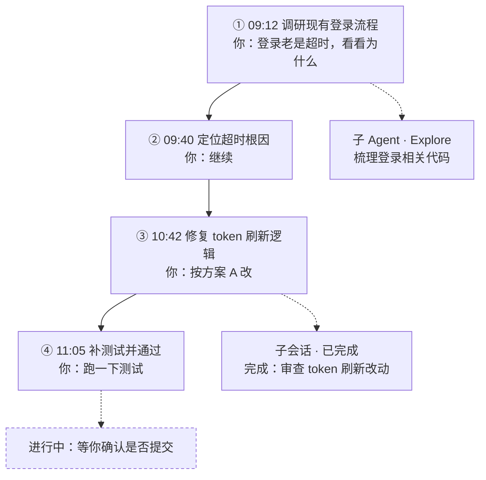

# 会话流程图与每轮摘要（技术方案）

状态：待确认 · 2026-10-15

## 背景

会话详情左栏现在用「之前 / 现在 / 下一步」回答「做到哪了」，但看不出会话是怎么一步步走过来的：先调研还是先改、在哪一步起了子 Agent、哪一轮失败返工。本方案在详情里加一张 mermaid 流程图，按轮次画出会话过程，并画出子 Agent。

画图需要每一轮的内容，而分析器每次都把最近 5 轮的 Agent 回复全文送给模型，token 消耗大。所以两件事一起做：**每次分析时顺带把新轮次压成 300～500 字的摘要存下来**；之后分析只送旧轮次的摘要和新轮次的全文，流程图也用这份数据画。

## 目标

1. 每轮对话在分析时生成一句话步骤名（≤30 字）和一段摘要（300～500 字），单独存进 SQLite，保留整个会话，不受现有 12 轮 / 40 条的上限约束。
2. 分析器输入改为：新轮次送全文，更早的轮次送全部已存摘要。
3. 详情左栏新增「流程图」折叠区：每轮一个节点，子 Agent 各一个节点（任务 + 结果），图下方逐轮列出步骤名和摘要。
4. 两类子 Agent 都画：会话内置子 Agent（Claude Task/Agent 工具、Codex 协作 Agent 等）和用 Paseo `create_agent` 起的子会话。

## 范围

**做**：摘要生成与存储、分析器输入改造、每轮子 Agent 提取、流程图生成与展示。

**不做（本期）**：给功能上线前的老轮次补摘要；把 `state.json` 里现有的各轮全文迁到 SQLite；流程图节点点击跳转（图是 PNG，不能点）；流程图放大查看。

## 关键事实（已核实）

| 事实 | 依据 | 对方案的影响 |
|---|---|---|
| 分析器每次送最近 5 轮的 `userInput` + `agentOutput` 全文，各自最多 16,000 字 | `server/service.ts` `buildInput`、`server/analyzer/prompt.ts` `buildAnalysisPrompt` | 旧轮次换成摘要能省大头 |
| 本机数据：138 个会话、550 轮，一轮回复平均约 2,400 字，最长 16,000 字 | 统计 `~/.paseo/plugin-data/session-manager/state.json` | 平均每次分析送约 1.2 万字；回复本来就短的轮次不需要模型摘要 |
| `state.json` 3.4MB，其中 2.7MB 是各轮全文；任何变化都整文件重写（300ms 防抖），序列化约 4ms | `server/store.ts` `JsonStateStore` | 现在没问题，但不适合继续往里塞随会话增长的数据 |
| 现有上限：200 个会话、每会话 12 轮、40 条「之前」 | `server/store.ts` `MAX_SESSIONS` / `MAX_TURNS_PER_SESSION`、`shared/types.ts` `MAX_HISTORY_ENTRIES` | 摘要放 JSON 会撞上限，放 SQLite 可以存整个会话 |
| 插件运行时是 Paseo Helper（Electron 44 / Node 24.20），自带 `node:sqlite`，实测可建库建表；本机测试用的 Node 22.19 也可用（打印实验特性警告） | `ELECTRON_RUN_AS_NODE=1 "Paseo Helper" -e ...` 实测 | 不用装 better-sqlite3 这类原生模块 |
| 一次分析只针对最新一轮；`historyTurnId` 之后的轮次标 `isNew`，可能一次有多轮新轮次；分析期间来了新一轮，本次结果作废 | `server/service.ts` `runAnalysis` | 摘要按轮 id 输出，每个 `isNew` 轮各一条；作废的那次不写摘要，下次这些轮仍是 `isNew` |
| 「之前」条目挂在被分析的那一轮 id 上，一次分析多轮时前几轮没有自己的条目 | `server/store.ts` `withTurnHistory` | 节点文字不能靠「之前」，要每轮单独的步骤名 |
| 内置子 Agent 在时间线里是 `tool_call`，`detail.type === "sub_agent"`，带 `subAgentType`（如 Explore）、`description`、`status`；Claude Task/Agent 工具和 Codex 协作 Agent 都映射成这一类 | `@getpaseo/plugin` `ProviderToolCallDetail`；daemon `buildClaudeSubagentCardDetail`、`mapCollabAgentToolCallItem` | 轮次结束时从 `turn_ended.timeline` 确定性提取，不用 LLM |
| Paseo 子会话有 `parentAgentId` 和 `createdAt`，看板已按此建立父子关系 | `shared/types.ts` `SessionView`、`client/board-model.ts` | 按创建时间落到父会话对应的轮次上，不解析 `create_agent` 调用 |
| mermaid 由服务端 `mmdc` 渲染成 PNG，客户端 `MermaidBlock` 按宽度缩放显示；源码上限 20,000 字符 | `server/mermaid.ts`、`client/markdown/mermaid-block.tsx` | 直接复用；图的规模要控制在上限内 |

## 方案

### 整体流程



### 存储：`history.db`

新文件 `$PASEO_HOME/plugin-data/session-manager/history.db`，新模块 `server/digest-store.ts` 独占访问，`state.json` 不变。

```sql
PRAGMA journal_mode = WAL;
CREATE TABLE IF NOT EXISTS turn_digest (
  session_id    TEXT    NOT NULL,
  turn_id       TEXT    NOT NULL,
  dedupe_key    TEXT    NOT NULL,          -- 与 Turn.dedupeKey 一致，内容变了就重置摘要
  completed_at  INTEGER NOT NULL,
  user_input    TEXT,                       -- 前 300 字
  outcome       TEXT    NOT NULL,           -- completed | failed
  edit_count    INTEGER NOT NULL DEFAULT 0,
  declared      TEXT,                       -- JSON，可空
  sub_agents    TEXT    NOT NULL DEFAULT '[]',  -- JSON，见下
  step          TEXT,                       -- ≤30 字，分析后写入
  digest        TEXT,                       -- ≤600 字
  digest_source TEXT,                       -- model | raw
  updated_at    INTEGER NOT NULL,
  PRIMARY KEY (session_id, turn_id)
);
CREATE INDEX IF NOT EXISTS turn_digest_by_time ON turn_digest(session_id, completed_at);
PRAGMA user_version = 1;
```

`sub_agents` 每项：`{ callId, type, description, status }`，`description` 截到 200 字，每轮最多存 20 个。

写入时机：

- **轮次写入**：`onTurnEnded` 和回填在 `record.turns` 里新增或替换一轮时，同步 upsert 一行。插件已经按 `id` / `dedupeKey` 去重，数据库跟着它走，不另做去重。`dedupe_key` 变了就清空 `step` / `digest`。`agentOutput` 不超过 500 字时，`digest` 直接存原文，`digest_source = 'raw'`。
- **分析结果**：`runAnalysis` 成功分支里，按 `turnDigests` 更新对应行的 `step`、`digest`（`digest_source = 'model'`）。不认识的 `turnId` 忽略。
- **删除**：`forget`、`removeRecord`、`reconcile` 删除记录时，同步删该会话的行。启动加载 `state.json` 后，删掉不在记录里的会话的行（`boundRecords` 超过 200 个会话时是在保存时悄悄丢弃的，靠这一步清理）。

`node:sqlite` 的 `DatabaseSync` 是同步接口，每次只写一行，耗时可以忽略。插件关闭时（`index.server.ts` 现有的 flush 旁边）关闭数据库。

**打不开时降级**：建库失败（运行时没有 `node:sqlite`、文件损坏等）只打一条警告，摘要功能整体关闭：分析器输入回到现在的 5 轮全文，流程图只用 `record.turns` 和「之前」画。写入失败同样只打警告，不影响看板。

### 分析器改动

**输入**（`AnalyzerInput.turns` 的组装改到 `service.ts` `buildInput`）：

| 轮次 | 送什么 |
|---|---|
| `isNew` 的轮次（最多最近 5 轮） | 和现在一样：`userInput`、`agentOutput` 全文，外加 `needsDigest`（回复超过 500 字为 true） |
| 更早、已有摘要的轮次 | `id`、`completedAt`、`userInput`（前 300 字）、`step`、`digest` |
| 更早、没有摘要、仍在最近 5 轮内的轮次（老数据、上次分析失败） | 和现在一样送全文 |
| 更早、没有摘要、已滑出最近 5 轮的轮次 | 不送 |

摘要按时间从旧到新排列，总长超过 40,000 字时从最旧的开始丢（只是保护上限，约 80 轮才会碰到）。

**输出**新增必填字段：

```json
"turnDigests": [
  { "turnId": "…", "step": "≤30 字，以动词开头", "digest": "300～500 字；needsDigest=false 时给空字符串" }
]
```

Schema 里 `turnDigests` 是对象数组，对象的三个字段都 `required`、`additionalProperties: false`，满足 Codex `--output-schema` 和 Claude `--json-schema` 的严格模式；Magpie 走 prompt 里的同一份 schema。解析（`server/analyzer/output.ts`）：缺字段或类型错时只丢这一条，不让整次分析失败；`step` 截到 30 字，`digest` 截到 600 字。

**提示词**新增规则（加进 `INVARIANT_INSTRUCTIONS`）：

> turnDigests 为 turns 中每个 isNew=true 的轮次各给一条。step 用一句话写这一轮做成了什么，以动词开头，不超过 30 字。needsDigest=true 时 digest 写 300～500 字的中文摘要：Agent 这一轮查了什么、改了什么、得出什么结论、还有什么没解决；保留文件路径、命令、数字和做出的决定，不写客套和过程性废话；needsDigest=false 时 digest 给空字符串。isNew=false 的轮次只给了摘要，不要为它们输出 turnDigests。

**token 影响**（按平均回复 2,400 字、摘要按上限 500 字估）：

| 会话轮数 | 现在（最近 5 轮全文） | 改后（新轮全文 + 旧轮全部摘要） |
|---|---|---|
| 1 | 约 2,400 字 | 约 2,400 字 |
| 5 | 约 12,000 字 | 约 4,400 字 |
| 10 | 约 12,000 字 | 约 6,900 字 |
| 20 | 约 12,000 字 | 约 11,900 字 |
| 40 | 约 12,000 字 | 约 21,900 字 |

20 轮以内省，超过 20 轮比现在多，换来分析器能看到整个会话。输出端每个新轮次多约 500 字。

### 流程图生成

新模块 `server/flow.ts`，纯函数，输入整理好的数据，输出 `{ code, turns }`。

**轮次来源**：SQLite 里该会话的行，加上 `record.turns` 里还没进数据库的老轮次，按 `completedAt` 排序。老轮次的节点文字依次取：该轮的「之前」条目 → 用户输入首行。

**节点**：

- 每轮一个节点：`③ 10:42 修复登录超时`，第二行 `你：<用户输入首行，前 20 字>`。纵向用实线依次连接。
- 失败的轮次（`outcome = failed`、首行声明「失败」）用红色描边；声明「阻塞」的用橙色描边。只改描边颜色，深浅主题下都能看清。
- 内置子 Agent：从轮次节点虚线连出，`子 Agent · Explore`，第二行是任务描述（前 30 字），失败或取消时加标记。
- Paseo 子会话：落在「上一轮结束 < 子会话创建时间 ≤ 本轮结束」的那一轮上；比最后一轮还晚的，挂在末尾的「进行中」节点上。文字是 `子会话 · <看板列名>`，第二行是它自声明的结果（「完成：…」）或标题。
- 每轮最多画 6 个子 Agent，多出来的合成 `另有 N 个子 Agent`。
- 会话正在运行时，末尾加一个虚线框节点 `进行中：<现在>`。
- 超过 30 轮时，只画最近 30 轮，前面合成一个 `更早 N 轮` 节点。

**转义**：标签一律加双引号；文字里的 `"`、`#`、`<`、`>`、`&` 换成 mermaid 实体（`#quot;` 等），换行压成空格，用 `<br/>` 分行。单轮节点文字有长度上限，30 轮总长约 1 万字符，低于 `MAX_MERMAID_CHARS`。

生成的源码示例：



### 接口

`shared/rpc.ts` 新增：

```ts
export const sessionFlowRpc = defineRpc({
  name: "session-manager.flow.get",
  input: z.object({ id: z.string() }),
  output: z.union([
    z.object({ ok: z.literal(true), code: z.string(), turns: z.array(FlowTurnSchema) }),
    z.object({ ok: z.literal(false), error: z.string() }),
  ]),
});
```

`FlowTurn`：`{ turnId, index, completedAt, userInput, step, digest, outcome, subAgents, children }`，供图下方的逐轮列表用。PNG 仍由现有 `session-manager.mermaid.render` 渲染，不在这个 RPC 里做。

### 界面

`client/detail-content.tsx` 在分隔线之后、「详细分析」之前加 `FoldSection`「流程图」，默认展开（用户 2026-10-15 确认）：

- 折叠区展开时请求 `flow.get`（默认展开，即打开详情就请求；收起后不再挂载），查询键带上 `session.updatedAt`，会话有新轮次时自动刷新。
- 上方是 `MermaidBlock`（复用现有的加载中、失败回退到源码、复制源码）。
- 下方是逐轮列表：`第 N 轮 · 时间 · 步骤名`，点开显示摘要和这一轮的子 Agent；`digest_source = raw` 的显示原文。
- 没有任何轮次时显示「还没有可画的轮次」。

客户端遵守 Hermes 约束：不用异步箭头函数，不在 `for...of` 里写闭包；effect 依赖只放 `session.id` 和 `session.updatedAt`。

## 变更点

| 文件 | 改动 |
|---|---|
| `server/digest-store.ts`（新） | `node:sqlite` 建库、upsert 轮次、写摘要、按会话读取、删除、清理孤儿行；打不开时返回空实现 |
| `server/turns.ts` | `turnFromTurnEnded` / `turnsFromTimelineEntries` 顺带提取 `sub_agent` 工具调用 |
| `server/service.ts` | 轮次写入同步数据库；`buildInput` 改为摘要 + 全文；`runAnalysis` 写回 `turnDigests`；删除记录时删行 |
| `server/analyzer/prompt.ts` | schema 增加 `turnDigests`；`needsDigest` 与摘要轮次的 prompt 结构；新规则 |
| `server/analyzer/output.ts` | 解析 `turnDigests`，逐条容错 |
| `server/flow.ts`（新） | 轮次合并、子 Agent 归属、mermaid 源码生成与转义 |
| `server/rpc-handlers.ts`、`shared/rpc.ts`、`shared/types.ts` | `flow.get` RPC 与 `FlowTurn` 类型；`Analysis` 增加可选 `turnDigests` |
| `index.server.ts` | 创建与关闭 `DigestStore` |
| `client/detail-content.tsx` | 「流程图」折叠区与逐轮列表 |

## 风险

| 风险 | 应对 |
|---|---|
| `node:sqlite` 仍是实验特性，Paseo 升级 Electron 后接口可能变 | 只在 `digest-store.ts` 一个文件里用；打不开时整体降级，不影响看板 |
| daemon 打包插件服务端代码时没把 `node:sqlite` 当内置模块，加载失败 | reload 后看 `paseo plugin logs session-manager`；`node:` 前缀在 esbuild `platform: node` 下默认外置，实现第一步先验证 |
| 摘要漏掉关键事实，之后的分析被带偏 | 规则要求保留路径、命令、数字和决定；最新一轮始终送全文，状态判断主要看它 |
| 模型不按长度写 | 解析时截断；`step` 30 字、`digest` 600 字 |
| 长会话的分析输入比现在大 | 40,000 字保护上限；超过 20 轮才会比现在多 |

## 验证

1. `npx tsc --noEmit && npm test`。新增单测：`digest-store`（内存库：upsert、内容变化重置摘要、删除、孤儿清理、打不开时降级）、`turns`（提取 `sub_agent`）、`prompt`（摘要轮次与全文轮次的组装、40,000 字上限、`needsDigest`）、`output`（`turnDigests` 逐条容错与截断）、`flow`（子会话归属、30 轮折叠、转义；生成的源码交给 `renderMermaid` 能渲染成功）。
2. `paseo plugin reload session-manager`；`grep "Loaded plugin" ~/.paseo/daemon.log | grep session-manager | tail -1` 确认有 `session-manager.flow.get`；`paseo plugin logs session-manager` 里没有 sqlite 相关错误。
3. 真实会话：跑一个至少 3 轮、其中一轮用 Claude Agent 工具起子 Agent、一轮用 `create_agent` 起 Paseo 子会话的会话，然后：
   - `sqlite3 ~/.paseo/plugin-data/session-manager/history.db "select turn_id, step, length(digest), digest_source, sub_agents from turn_digest order by completed_at desc limit 10"`，确认每轮都有行、长回复有 `model` 摘要、子 Agent 已记录。
   - 打开详情展开「流程图」，节点顺序、子 Agent 节点和「进行中」节点正确；关掉重开详情能看到新代码。
4. 分析输入大小：分析时打一行 `analysis input chars=…`，同一会话改前改后各看一次，确认 5 轮以上的会话明显下降。

## 待确认

1. ~~流程图放在分隔线后的折叠区、默认收起~~ → 已改为默认展开（2026-10-15）。
2. 摘要总长保护上限 40,000 字。
